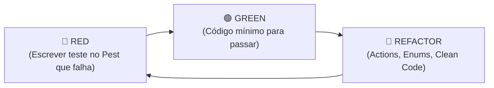

# Laravel Testing with TDD (Pest v4)

Test-Driven Development (TDD) workflow for Laravel 13 and Inertia.js v3 using Pest PHP v4, factories, and Laravel testing helpers.

---

## When to Activate

- Driving new features or bug fixes test-first (RED -> GREEN -> REFACTOR).
- Writing feature tests for Inertia pages, FormRequests, and Controllers.
- Testing Eloquent models, relationships, scopes, and Backed Enum casts.
- Testing authorization boundaries (`Gate`, `Policy`, guest redirects).
- Mocking asynchronous jobs, mail, notifications, and external HTTP calls.

---

## The TDD Workflow (Red-Green-Refactor)



### 1. 🔴 RED — Escrever o Teste Primeiro
Crie o arquivo de teste em `tests/Feature/...` antes de criar a controller ou action. Execute o teste para confirmar que ele falha com a razão esperada (ex: rota 404 ou validação ausente).

```php
declare(strict_types=1);

use App\Enums\StatusPedido;
use App\Models\Order;
use App\Models\User;

test('cliente autenticado pode criar um pedido', function () {
    $user = User::factory()->create();

    $response = $this->actingAs($user)->post(route('pedidos.store'), [
        'customer_id' => $user->id,
        'status' => StatusPedido::Pendente->value,
        'total_cents' => 15000,
    ]);

    $response->assertRedirect(route('pedidos.index'));

    $this->assertDatabaseHas('orders', [
        'customer_id' => $user->id,
        'status' => StatusPedido::Pendente->value,
        'total_cents' => 15000,
    ]);
});
```

Execute o teste:
```bash
php artisan test --filter "cliente autenticado pode criar um pedido"
```
*Falha esperada: rota não encontrada ou controller ausente.*

---

### 2. 🟢 GREEN — Código Mínimo para Passar
Implemente apenas a rota, controller e action necessários para que o teste passe.

---

### 3. 🔵 REFACTOR — Refatorar com Segurança
Com o teste verde:
- Extraia regras de negócio para uma Action transacional (`final readonly class`).
- Garanta **Zero Strings Mágicas** com PHP Backed Enums (`app/Enums/`).
- Garanta **Raw Data Only** (centavos inteiros, datas ISO).
- Execute a suite de verificação: `composer verify`.

---

## Configuração do Pest no Starter Kit

No Starter Kit, o `tests/Pest.php` já vincula automaticamente a trait `RefreshDatabase` e helpers como `actAsUser()` para todos os testes dentro de `tests/Feature/`:

```php
// tests/Pest.php
pest()->extend(TestCase::class)
    ->use(RefreshDatabase::class)
    ->in('Feature');
```

---

## Testando Páginas Inertia.js v3

No Starter Kit com Inertia.js, **NÃO use** `assertViewHas()`. Use as asserções canônicas do Inertia:

```php
declare(strict_types=1);

use App\Models\Order;
use App\Models\User;
use Inertia\Testing\AssertableInertia as Assert;

test('exibe a listagem de pedidos com paginação para usuários autenticados', function () {
    $user = User::factory()->create();
    Order::factory()->count(5)->create(['customer_id' => $user->id]);

    $response = $this->actingAs($user)->get(route('pedidos.index'));

    $response->assertOk()
        ->assertInertia(fn (Assert $page) => $page
            ->component('pedidos/index')
            ->has('pedidos.data', 5)
            ->where('filtros.busca', null)
        );
});
```

---

## Model Factories com Enums e Centavos

As factories devem refletir as regras de ouro do projeto (sem strings mágicas e com valores monetários em centavos inteiros):

```php
declare(strict_types=1);

namespace Database\Factories;

use App\Enums\StatusPedido;
use App\Models\User;
use Illuminate\Database\Eloquent\Factories\Factory;

/**
 * @extends Factory<\App\Models\Order>
 */
final class OrderFactory extends Factory
{
    public function definition(): array
    {
        return [
            'customer_id' => User::factory(),
            'status' => StatusPedido::Pendente,
            'total_cents' => fake()->numberBetween(1000, 50000), // Ex: R$ 10,00 a R$ 500,00
        ];
    }

    public function pago(): static
    {
        return $this->state(fn (array $attributes) => [
            'status' => StatusPedido::Pago,
        ]);
    }
}
```

---

## Testes de Autorização & Validação

### Testando Validação do FormRequest
```php
test('falha ao criar pedido sem campos obrigatórios', function () {
    $user = User::factory()->create();

    $this->actingAs($user)
        ->post(route('pedidos.store'), [])
        ->assertSessionHasErrors(['customer_id', 'status', 'total_cents']);
});
```

### Testando Limites de Acesso (Policies/Gates)
```php
test('usuário comum não pode excluir pedido de outro usuário', function () {
    $dono = User::factory()->create();
    $invasor = User::factory()->create();
    $pedido = Order::factory()->create(['customer_id' => $dono->id]);

    $this->actingAs($invasor)
        ->delete(route('pedidos.destroy', $pedido))
        ->assertForbidden();

    $this->assertDatabaseHas('orders', ['id' => $pedido->id]);
});
```

---

## Fakes e Mocks no Laravel

### E-mails Assíncronos (`Mail::assertQueued`)
> **Atenção:** Como as Mailables do projeto implementam `ShouldQueue`, use SEMPRE `Mail::assertQueued()`.

```php
use App\Mail\PedidoCriadoMail;
use Illuminate\Support\Facades\Mail;

test('enfileira e-mail de confirmação após criação de pedido', function () {
    Mail::fake();

    $user = User::factory()->create();

    $this->actingAs($user)->post(route('pedidos.store'), [
        'customer_id' => $user->id,
        'status' => StatusPedido::Pendente->value,
        'total_cents' => 10000,
    ]);

    Mail::assertQueued(PedidoCriadoMail::class, function (PedidoCriadoMail $mail) use ($user) {
        return $mail->hasTo($user->email);
    });
});
```

### Filas / Jobs (`Queue::fake`)
```php
use App\Jobs\ProcessarPagamentoJob;
use Illuminate\Support\Facades\Queue;

test('despacha job de processamento de pagamento', function () {
    Queue::fake();

    $order = Order::factory()->create();

    // Executa a action que despacha o job
    app(FinalizarPedidoAction::class)->execute($order);

    Queue::assertPushed(ProcessarPagamentoJob::class, function ($job) use ($order) {
        return $job->order->id === $order->id;
    });
});
```

### Requisições HTTP Externas (`Http::fake`)
```php
use Illuminate\Support\Facades\Http;

test('consome api de gateway com sucesso', function () {
    Http::fake([
        'api.gateway.com/*' => Http::response(['id' => 'tx_123', 'status' => 'approved'], 200),
    ]);

    $resultado = app(GatewayPagamentoService::class)->cobrar(15000);

    expect($resultado['status'])->toBe('approved');
});
```

---

## Comandos Diagnósticos e Verificação

Para executar e verificar os testes no projeto:

```bash
# Executa todos os testes com saída compacta (Pest v4)
php artisan test --compact

# Executa testes com filtro por arquivo ou nome
php artisan test --filter PedidoTest

# Executa a suite de verificação obrigatória (Oxlint, Rector, PHPStan max, Pint e Pest)
composer verify
```

---

## Padrões DO / DON'T no TDD

| ✅ DO | ❌ DON'T |
| :--- | :--- |
| Use factories (`Model::factory()->create()`) para preparar cenários | Não insira dados com `DB::table()->insert()` nos testes |
| Use `expect($valor)->toBe(...)` para asserções legíveis no Pest | Não use assertions legadas do PHPUnit quando desnecessário |
| Teste respostas do Inertia com `assertInertia()` | Não use `assertViewHas()` para telas frontend Inertia |
| Verifique jobs e e-mails com `Queue::fake()` e `Mail::fake()` | Não dispare e-mails reais em ambiente de teste |
| Escreva o teste ANTES de implementar (RED -> GREEN -> REFACTOR) | Não escreva testes apenas no final como obrigação burocrática |
