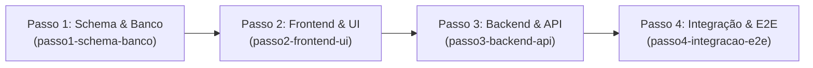

# 📋 Especificação do Módulo (`CONTEXT.md`)

> **Instruções para a IA**:
> 1. Consulte o `MEMORY.md` antes de iniciar qualquer tarefa.
> 2. Execute **uma tarefa por vez** seguindo estritamente a ordem do checklist abaixo.
> 3. Ao finalizar uma tarefa com sucesso e passar no `composer verify`, marque o checkbox `[x]`.
> 4. Os 4 agentes (`passo1-schema-banco`, `passo2-frontend-ui`, `passo3-backend-api`, `passo4-integracao-e2e`) realizam o `git commit` automaticamente a cada tarefa concluída em português (`feat`, `refactor`, `fix`, `chore`). NUNCA faça `git push` de forma autônoma.

---

## 📌 Visão Geral do Módulo Atual
<!-- Preencher com a descrição do módulo que será construído -->
- **Nome do Módulo**: [A definir]
- **Objetivo**: [A definir]
- **Entidades Principais**: [A definir]

---

## 🔄 Fluxo de Desenvolvimento em 4 Passos

---

### 🗄️ Passo 1: Schema, Enums & Banco (`passo1-schema-banco`)
Responsável pelo modelamento de banco de dados, enums tipados, models com casts estritos, migrations sem `down()`, factories e seeders.

- [ ] **1.1. Enums PHP & TypeScript**: Criar PHP Backed Enums em `app/Enums/` e espelhar exatamente em `resources/js/types/` (sem strings mágicas).
- [ ] **1.2. Migration**: Criar migration evolutiva apenas com `up()`, com chaves estrangeiras seguras (`restrictOnDelete` / `nullOnDelete`), índices adequados e campos brutos.
- [ ] **1.3. Model**: Definir Model com `$fillable`, `casts(): array` tipados (Enums, datas, booleans) e relacionamentos.
- [ ] **1.4. Factory & Seeder**: Criar Factory com estados coerentes e Seeder associado.
- [ ] **1.5. Verificação**: Executar `php artisan migrate`, `php artisan db:seed` e `composer verify`.
- [ ] **1.6. Commit**: `feat(database): criar migrations, models, enums e seeders de [modulo]`.

---

### 🎨 Passo 2: Frontend & Interface do Usuário (`passo2-frontend-ui`)
Responsável pela construção visual e componentes com React 19, Inertia.js v3, Tailwind CSS v4 e Shadcn/UI, seguindo as diretrizes de design e usabilidade.

- [ ] **2.1. Tipos TypeScript**: Definir interfaces em `resources/js/types/` alinhadas 100% com o backend (campos em `snake_case`, dados brutos).
- [ ] **2.2. Página de Listagem**: Criar `resources/js/pages/[modulo]/index.tsx` com container fluido (`p-4 md:p-6`, sem `max-w-*`), cabeçalho de título, busca unificada, filtros em linha, contadores/tabs e tabela responsiva com cards mobile agnósticos.
- [ ] **2.3. Modal ou Página de Cadastro/Edição**:
  - Se $\le$ 8 campos: Modal (`sm:max-w-3xl`) com validação Precognition em tempo real e foco acessível.
  - Se > 8 campos: Página dedicada.
- [ ] **2.4. Modal de Confirmação**: Usar padrão de confirmação com título/botão destrutivo em `#ce3765` para inativação lógica.
- [ ] **2.5. Menu Sidebar**: Registrar item de navegação no menu lateral da aplicação com ícone Lucide adequado.
- [ ] **2.6. Verificação**: Executar `npm run build` ou `composer verify` para validar componentes e tipagens.
- [ ] **2.7. Commit**: `feat(ui): implementar telas de listagem e formulario de [modulo]`.

---

### ⚙️ Passo 3: Backend, Regras de Negócio & API (`passo3-backend-api`)
Responsável por Thin Controllers, FormRequests com Precognition, Actions transacionais puras e rotas nomeadas.

- [ ] **3.1. FormRequests**: Criar Requests específicos (`IndexRequest`, `StoreRequest`, `UpdateRequest`) com regras de validação estritas (sem `authorize()` desnecessário e sem `prepareForValidation()` redundante).
- [ ] **3.2. Actions Transacionais**: Criar Actions isoladas em `app/Actions/[Modulo]/` encapsuladas em `DB::transaction()` para mutações (sem injeção no `__construct` do Controller).
- [ ] **3.3. Thin Controller**: Implementar Controller enxuto que recebe o FormRequest validado, delega para a Action e retorna `Inertia::render()` com dados brutos ou redirecionamento.
- [ ] **3.4. Rotas & Wayfinder**: Registrar rotas em `routes/web.php` e executar `php artisan wayfinder:generate --with-form`.
- [ ] **3.5. Verificação**: Executar `composer verify` (PHPStan nível estrito e Pint).
- [ ] **3.6. Commit**: `feat(api): implementar controller, form requests e actions de [modulo]`.

---

### 🧪 Passo 4: Integração, Testes & E2E (`passo4-integracao-e2e`)
Responsável pela validação ponta a ponta, conectando UI via rotas tipadas do Wayfinder com Precognition e cobrindo com testes automatizados Pest v4.

- [ ] **4.1. Conexão UI ↔ Wayfinder**: Conectar botões, formulários e links aos métodos gerados do Wayfinder (`@/actions/...` ou `@/routes/...`) com `useForm` ou Precognition.
- [ ] **4.2. Testes de Feature (Pest)**: Criar testes cobrindo:
  - Renderização da listagem e filtros.
  - Validação de dados no cadastro e atualização.
  - Execução bem-sucedida de criação, edição e inativação lógica.
  - Permissões e proteção de rotas.
- [ ] **4.3. Verificação de Integridade**: Rodar `composer verify` (Oxlint, Rector, PHPStan, Pint e Pest).
- [ ] **4.4. Commit**: `test(e2e): adicionar testes automatizados e integracao do [modulo]`.

